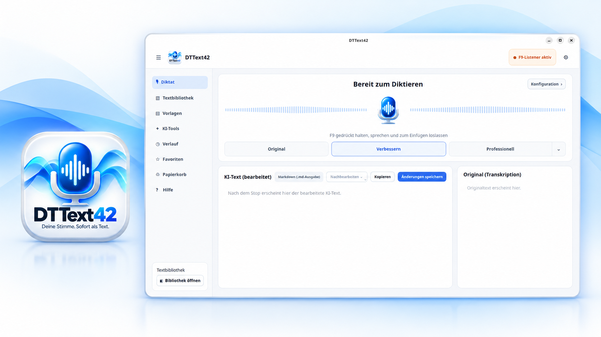

  

# DTText42 – Sprechen. Denken. Text entsteht. 👍

**Eine Taste. Sprechen. Text erscheint.**

DTText42 – kurz für **Deep Thought Text 42** – ist eine leistungsfähige Diktier- und Schreibanwendung für Ubuntu Linux. Sie verwandelt gesprochene Gedanken in brauchbaren Text: lokal transkribiert, auf Wunsch sprachlich verbessert, sicher eingefügt und dauerhaft in einer übersichtlichen Textbibliothek gespeichert.

Setze den Cursor in ein Textfeld, halte **F9** gedrückt, sprich und lasse die Taste wieder los. DTText42 erledigt den Rest. Einfach im Alltag, aber mit deutlich mehr Möglichkeiten als ein gewöhnliches Diktierprogramm.

## Was DTText42 besonders macht

- **Diktieren mit einer Taste:** F9 gedrückt halten, sprechen, loslassen. Die Aufnahme bleibt sichtbar und kann jederzeit beendet werden.
- **Lokale Spracherkennung:** Das mitgelieferte Faster-Whisper-Modell `small` kann Sprache direkt auf dem eigenen Rechner in Text umwandeln – ohne verpflichtenden Cloud-Dienst.
- **Optionale KI-Schreibstile:** Texte lassen sich verbessern, freundlich oder professionell formulieren, als E-Mail aufbereiten, strukturieren, zusammenfassen, übersetzen oder mit einer eigenen Anweisung bearbeiten.
- **Original bleibt erhalten:** Die ursprüngliche Transkription bleibt sichtbar, auch wenn DTText42 daraus eine überarbeitete Fassung erstellt.
- **Sicheres Einfügen:** DTText42 fügt höchstens einmal ein und sendet niemals automatisch Enter. Bei einem Fokuswechsel, Passwortfeld oder unsicheren Ziel bleibt der Text sicher in der Zwischenablage.
- **Eigene Textbibliothek:** Diktate können automatisch als lesbare Markdown-Dateien gespeichert, durchsucht, bearbeitet, exportiert, als Favorit markiert oder zu neuen Dokumenten zusammengeführt werden.
- **Verlauf und Papierkorb:** Texte lassen sich wieder öffnen; archivierte Bibliothekseinträge können wiederhergestellt werden.
- **Deutsch und Englisch:** Oberfläche, lokale Erkennung und optionale Schreibstile unterstützen beide Sprachen.
- **Datenschutz mit klarer Entscheidung:** DTText42 besitzt keine Telemetrie. Audio und Texte bleiben standardmäßig lokal. Externe Anbieter werden nur verwendet, wenn sie bewusst eingerichtet und freigegeben wurden.

## So einfach funktioniert es

1. Cursor in ein normales Textfeld setzen.
2. **F9 gedrückt halten.**
3. Gedanken frei aussprechen.
4. **F9 loslassen.**
5. DTText42 transkribiert den Text und fügt ihn ein – oder legt ihn sicher in die Zwischenablage, wenn das Ziel nicht eindeutig geprüft werden kann.

So entstehen Notizen, E-Mails, Dokumentationen, Ideen, Anleitungen oder längere Texte, ohne jeden Satz über die Tastatur schreiben zu müssen.

## Die Idee hinter dem Namen

Inspiriert wurde DTText42 von Christoph Magnussens **BlitzText** für Apple. DTText42 ist eine eigenständige Umsetzung für Ubuntu Linux und entwickelt die Grundidee weiter: von der schnellen Spracheingabe bis zur bewussten Textverbesserung und einer vollständigen lokalen Textbibliothek.

Der Name **Deep Thought Text 42** ist eine augenzwinkernde Anlehnung an *Deep Thought* und die berühmte Zahl 42 aus *Per Anhalter durch die Galaxis*. DTText42 ist dennoch ein eigenständiges Projekt und kein Bestandteil einer anderen Anwendung. BlitzText und die genannten Werke und Marken gehören ihren jeweiligen Rechteinhabern; es besteht keine offizielle Verbindung.

## Download und Installation

[**👍 DTText42 0.5.8 für Ubuntu Linux herunterladen**](https://github.com/dennisdeckena-star/DTText42-Downloads/releases/tag/v0.5.8)

Geprüfte Zielumgebung: **Ubuntu 26.04.1 LTS, GNOME/Wayland, amd64**.

1. Unter **Releases** die Datei `DTText42-0.5.8-Installieren` herunterladen.
2. Die Datei ausführbar machen: `chmod +x DTText42-0.5.8-Installieren`
3. Den Installer starten: `./DTText42-0.5.8-Installieren`

Der Installer zeigt den Fortschritt an und fordert die erforderliche Systemfreigabe sichtbar an. Andere Distributionen, Ubuntu-Versionen, Architekturen oder Desktop-Sitzungen wurden für diese Version noch nicht praktisch bestätigt.

## Integritätsprüfung

SHA-256:

`fdc87ad82095a56bd47c0aa2f50a9483ff9931e502960aac39602ce56b0ca14e`

Prüfen mit: `sha256sum DTText42-0.5.8-Installieren`

## Hinweis zu externen KI-Diensten

Die lokale Transkription, Zwischenablage und Textbibliothek funktionieren ohne externe Text-KI. Wer optionale Cloud- oder KI-Anbieter aktiviert, benötigt gegebenenfalls einen eigenen API-Schlüssel; abhängig vom Anbieter können Kosten und eigene Datenschutzbedingungen gelten.

Dieses öffentliche Repository dient ausschließlich als offizielle Downloadseite. Der Anwendungsquellcode wird getrennt in einem privaten Repository verwaltet.
